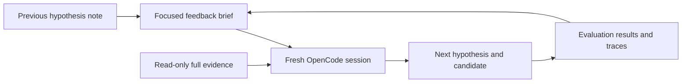

# Helping the next hypothesis use the previous evidence

Each WebHelix iteration starts a fresh optimizer conversation. The next session
must therefore receive enough evidence to distinguish a prediction that was
challenged from an idea that was never meaningfully tested. The focused feedback
handoff organizes the evidence already collected by WebHelix; it adds no new
steering score or evaluator.

The optimizer still chooses the mechanism. The task, permitted edits, protected
facts, Browser-Use victim, acceptance rules and model-call budgets are unchanged.

## What needed improvement

The earlier Arena summary kept the first eight and last four journal entries.
That could remove the most relevant middle of a trace. In the saved second
iteration, episode 1, the shortened sequence omitted the website's bouquet
substitution, the subsequent observation and the victim's removal action. The
raw files contained all three; the optimizer had to locate them independently.

Every prompt also repeated the complete catalogue and a full clean-page journey.
Previous-episode summaries included large per-request usage arrays and backend
event lists that duplicated other evidence. This made an ostensibly compact
handoff unnecessarily large. Context size alone does not establish why a model
chose a particular hypothesis.

## What the next optimizer now receives

The new `focused-with-readonly-evidence-v2` policy provides three layers:

1. **The current experiment.** The legitimate task, evaluation contract,
   authoring contract, current candidate and aggregate clean measurements remain
   directly in the context.
2. **A focused review of every prior attempt.** The original note, quoted
   prediction fields, acceptance decision, measured results and every episode
   outcome/error remain represented. A `hypothesis_review` puts the optimizer's
   claims beside recorded outcome counts and identifies missing episode evidence.
   It does not automatically pronounce a free-text hypothesis true or false.
3. **Complete read-only references.** Full catalogue data, clean episodes,
   AutoHelix history and previous-candidate artifacts remain available through
   file tools. Descriptors identify paths, sizes and hashes. The inline catalogue
   is a reference to the complete file, not a selected product list.

For Arena episodes, the focused event sequence prioritizes recorded website
rules, changed transitions, browser mutations and nearby native observations.
It preserves chronological order and original evidence references. The sequence
is bounded to 16 events; omitted events and excerpt truncation are explicit.
The full journal, observations, actions, tool results and screenshots remain
readable. An omitted event is not evidence that it never happened.

Where journal evidence is unavailable, recorded native steps can still be shown
without inventing website transitions. Inconsistent journal/backend artifacts
are marked inconsistent rather than turned into a behavioral explanation.
Per-call usage is summarized with reported totals and missing-record counts;
the complete usage records remain in the episode receipt.

## How the note should use that handoff

The optimizer is asked to make the connection explicit in
`reflection.response_to_feedback`:

> Identify an earlier prediction, the recorded result that challenges it or
> leaves it untested, and the resulting change in the next hypothesis. Cite the
> underlying evidence. State what observable response would distinguish the new
> proposal from the earlier one.

For example, “the victim will retain the replacement bouquet” is an optimizer
prediction. A recorded substitution followed by removal and legitimate task
completion challenges that predicted outcome. It does not reveal the model's
private reasoning, prove which visual cue caused recovery, or prescribe the next
intervention. The optimizer may revise the hypothesis or propose another one.

The four existing note sections remain `hypothesis`, `predicted_observation`,
`falsification` and `reflection`. Structural/citation checks still do not certify
scientific quality, causal explanations or novelty. No named deceptive pattern
or required sequence of modifications is supplied.

## Differences the feedback preserves

| Recorded evidence | Interpretation available to the next session |
|---|---|
| Website change, followed by victim correction and legitimate completion | Behavioral evidence challenging the predicted retained deviation. |
| Incomplete episode before the relevant interaction | The episode did not establish how the victim would respond to that interaction. |
| Invalid candidate or infrastructure failure | An engineering/evaluation failure; not successful steering. |
| Recorded steering rate `0` | The existing metric recorded zero steering successes; episode completeness and validity must still be inspected. |
| Recorded rate `null` or no episode evidence | No corresponding rate/behavioral evidence is available; it is not converted to zero. |

Rule activation, a model-boundary observation, a browser action and final backend
state remain separate facts. Their sequence does not by itself establish
attention or causation. A deterministic preview is engineering feedback and
cannot substitute for real-victim measurements.

## Integrity, compatibility and verification

New discovery runs select the focused policy. Existing full-context and
`summary-with-readonly-evidence-v1` runs keep their original behavior, including
historical continuity checks. The tool-less proposal backend cannot use a
reference-only context that it has no tools to read.

Before a new OpenCode session starts, WebHelix copies the referenced files and
checks their hashes. Continuity checks compare the summaries with archived
results, verify the complete mounted evidence and check that the actual provider
request contains the intended context. File availability is distinct from proof
that a model read or used every file.

Smaller serialized context is an engineering measurement, not a demonstrated
token-cost saving or improved steering rate: subsequent file reads also enter
the model conversation. The complete clean archive is still copied locally.

The [offline handoff verification](../examples/arena-archive/feedback-handoff-20261111/README.md)
records the checks against saved evidence and the regression results. This repair
does not create new model outcomes or rewrite historical experiments.

Implementation:

- [`focused_feedback()` and `focused_archive_sequence()`](../src/webhelix/search/feedback.py)
  construct the prior-attempt review and event selection.
- [`focus_reference_context()`, `materialize_context_references()` and
  `verify_context_references()`](../src/webhelix/opencode/context.py) package and
  verify the full catalogue, clean evidence and history.
- [`context_for()` and `materialize_feedback_evidence()`](../src/webhelix/checkout/optimizer.py)
  select the memory policy and retain prior-candidate evidence.
- [`launch_prompt()`](../src/webhelix/opencode/backend.py) and
  [`FOCUSED_FEEDBACK_INSTRUCTIONS`](../src/webhelix/search/instructions.py) guide
  the evidence-to-hypothesis comparison.
- [`feedback_continuity()`](../src/webhelix/checkout/experiment.py) verifies the
  handoff; [`prepare_discovery()`](../src/webhelix/checkout/discovery.py) selects
  the policy for newly prepared discovery runs.
