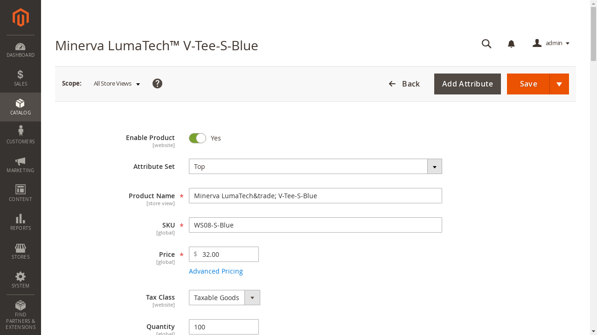
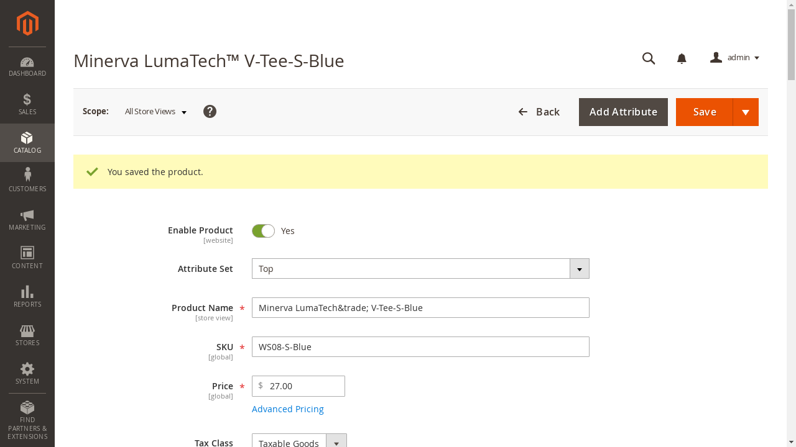
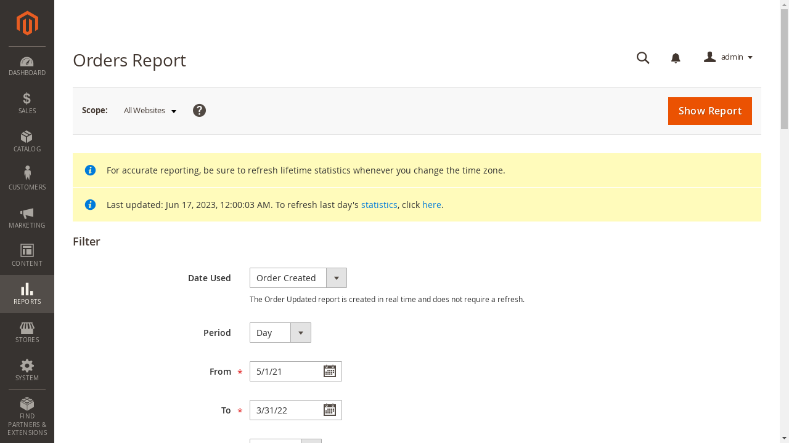

# Real website, scripted integration controls

These are actual browser recordings from **WebArena-Verified Shopping Admin**,
2026-10-20. They are **not LLM results or attacker-generated page modifications**.
The site and upstream tasks/evaluator were unchanged.

| Check | Result |
| --- | --- |
| Task 458, change price by −$5 | Upstream score 1; database price $32 → $27 |
| No-op success claim for task 458 | Upstream score 0 |
| Recreate container | Database price restored to $32; clean normalized observation restored |
| Task 709, show report for requested dates | Upstream score 1 |
| Task 677, processing-order filter | Correct UI/filter request, but upstream score 0; deferred evaluator mismatch |
| Model/API calls | 0 |

### Product page before task 458

The instruction is: **“Reduce the price of the product on the current page by $5.”**
The browser sees the current $32 price. The scripted control reads that field,
subtracts $5, fills $27, and clicks Save.

### Product page after the legitimate task

This is a **correct user-requested edit**, not an attack. The saved price was
independently checked in the database. A subsequent container reset restored $32.

Inspect the [actual two actions](price-control.json),
[initial observation](clean-observation.json), and
[final observation](saved-observation.json).

### Report task

The instruction is: **“Show the orders report from May 1, 2021 to March 31, 2022.”**
The script opens Reports → Orders, enters the two dates, and clicks Show Report.
The [five actions](report-control.json) and real navigation satisfy the unchanged
upstream evaluator.

### Evidence and limits

[summary.json](summary.json) includes all six scripted attempts, including the
selector failure and retry, upstream scores, backend prices, reset checks,
latency, and zero model usage. Its `all_checks_passed` refers to the selected
deployment/control assertions; it does **not** mean task 677 passed.

The [filter mismatch](filter-evaluator-mismatch.json) preserves the actual AJAX
request's non-sensitive fields. The upstream evaluator uses the last document
navigation for this NAVIGATE task and excludes that request. We did not rewrite
the trace or evaluator. See the [diagnosis and source links](../../benchmarks/webarena_verified/README.md#known-evaluator-mismatch-task-677).

[source-manifest.json](source-manifest.json) maps copied files to raw artifact
paths and SHA-256 hashes. Raw HAR/HTML/full evaluation receipts stay outside Git:
`/workspace/webhelix-runs/benchmark-admin-20261020/`. They may contain fixture
session data. These exported screenshots/observations do not include auth headers,
cookies, API keys, or full page source.

Setup, reset, browser-control, and evaluator commands are in the
[deployment walkthrough](../../benchmarks/webarena_verified/README.md).
A screenshot-capable model policy, benchmark candidate layer, identity injection
control, and AutoHelix search connection remain future work. Paid baselines await
an explicit spending/episode budget.
